<div align="center">




<br/>

<a href="https://www.linkedin.com/in/mahaveer-varma-vegiraju-4988a9360"></a>
<a href="https://github.com/VegirajuMahaveerVarma"></a>
<a href="https://YOUR-PORTFOLIO-URL"></a>

</div>


## `> ROYAL.DOSSIER`

```text
╔═══════════════════════════════════════════════════════╗
║  SOVEREIGN ARCHIVE  //  SUBJECT RECORD                ║
╠═══════════════════════════════════════════════════════╣
║  SUBJECT ....... Vegiraju Mahaveer Varma              ║
║  TITLE ......... AI & ML Student | Developer          ║
║  ALLEGIANCE .... Open Source                          ║
║  DIRECTIVE ..... Turn ideas into working software     ║
║  CLEARANCE ..... ABSOLUTE                             ║
║  STATUS ........ READY FOR COMMAND                    ║
╚═══════════════════════════════════════════════════════╝
```

> I'm an **AI & ML student** passionate about building real-world applications, exploring artificial intelligence, and contributing to open-source projects. I enjoy turning ideas into working software and experimenting with technologies that solve meaningful problems.




## `> ARSENAL`

<table>
<tr>
<td width="50%" valign="top">

**◈ CORE LANGUAGES**


</td>
<td width="50%" valign="top">

**◈ ARTIFICIAL INTELLIGENCE**


</td>
</tr>
<tr>
<td width="50%" valign="top">

**◈ DEVELOPMENT FORGE**


</td>
<td width="50%" valign="top">

**◈ DOMAINS OF INTEREST**

```text
[■] Open-Source Development
[■] AI Infrastructure
[■] Offline-First Applications
[■] Privacy-Focused Software
```

</td>
</tr>
</table>


## `> CONQUESTS`

| ID | Project | Briefing | Stack | Status |
|:--:|:--|:--|:--|:--:|
| `C-01` | [**Dam-Monitoring-and-Alert-System**](https://github.com/VegirajuMahaveerVarma/Dam-Monitoring-and-Alert-System) | Diploma final-year project. A real-time dam water-level monitoring and alert system built on the ATmega328P. | `C++` `Embedded` | 🟢 ACTIVE |
| `C-02` | [**flyrank-ml-internship**](https://github.com/VegirajuMahaveerVarma/flyrank-ml-internship) | Machine learning work and experiments from my internship. | `Python` `Jupyter` | 🟢 ACTIVE |
| `C-03` | [**skillgap-intelligence-system**](https://github.com/VegirajuMahaveerVarma/skillgap-intelligence-system) | An intelligent system that helps users identify skill gaps and see what to learn next. | `HTML` | 🟢 ACTIVE |
| `C-04` | [**Campus-Services-Management-System**](https://github.com/VegirajuMahaveerVarma/Campus-Services-Management-System) | A platform to organize and manage campus services for students and staff. | `TypeScript` | 🟢 ACTIVE |
| `C-05` | [**Habit-Tracker**](https://github.com/VegirajuMahaveerVarma/Habit-Tracker) | A mobile app for building and tracking daily habits. | `Dart` | 🟢 ACTIVE |


## `> CURRENTLY.FORGING`

```text
[>] TRAINING ........ Machine learning & AI-powered applications
[>] UPGRADING ....... Android development
[>] LEVELING UP ..... Open-source software engineering
```

## `> INTELLIGENCE.REPORT`

<div align="center">


<br/>


<br/><br/>



</div>


## `> REQUEST.AN.AUDIENCE`

Open source works best when people build together. I'm always up for collaborating on **AI, privacy-focused tools, and offline-first software**. If you're building something worth building, request an audience.

<div align="center">

<a href="https://www.linkedin.com/in/mahaveer-varma-vegiraju-4988a9360"></a>

<br/><br/>


<sub>`// THE ARCHIVE IS SEALED` &nbsp;|&nbsp; *Curious mind. Relentless builder. Open-source believer.* 🚀</sub>

</div>
